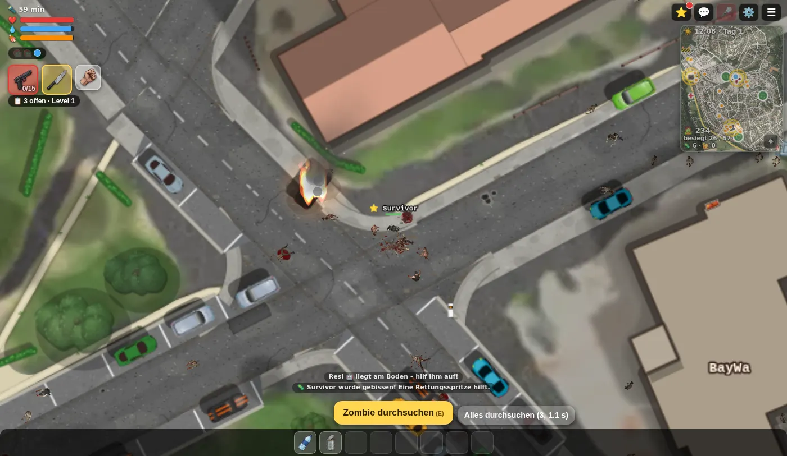
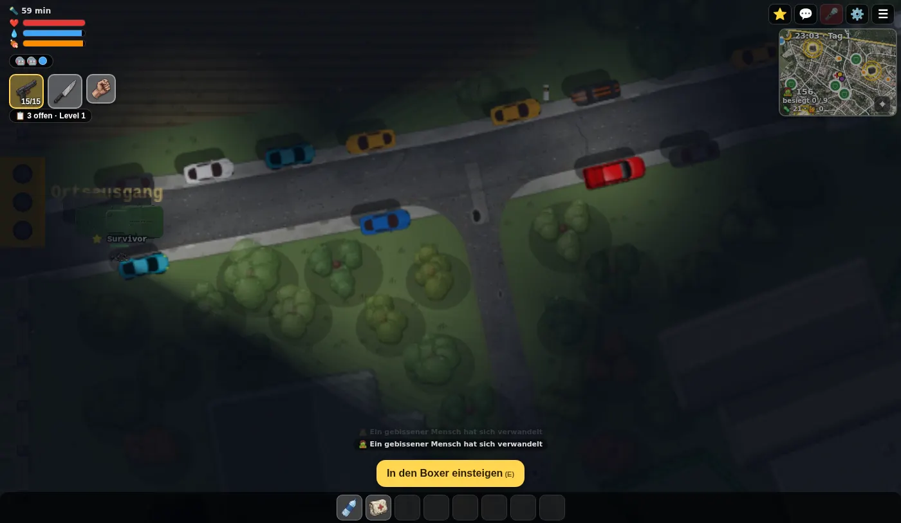
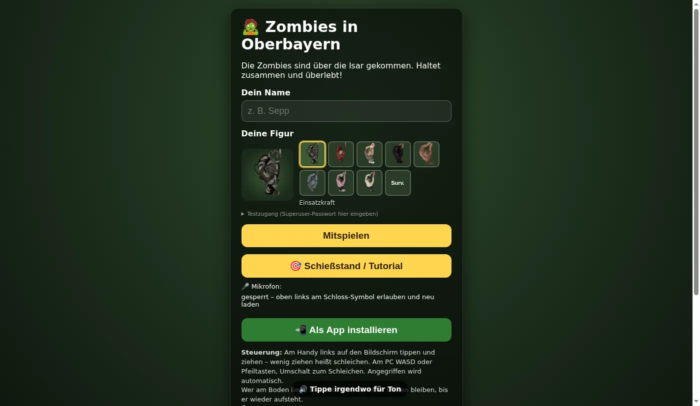
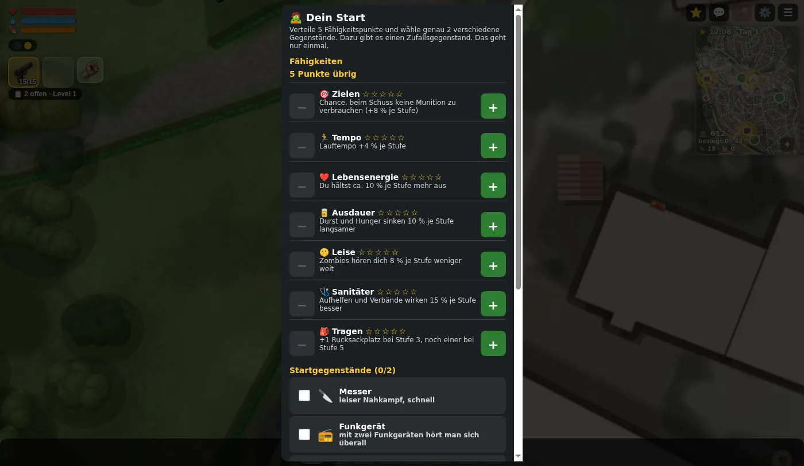
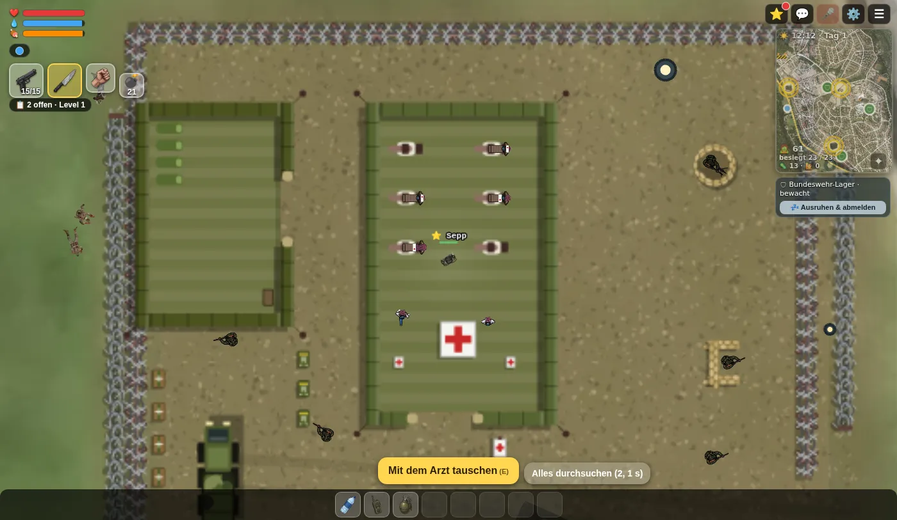
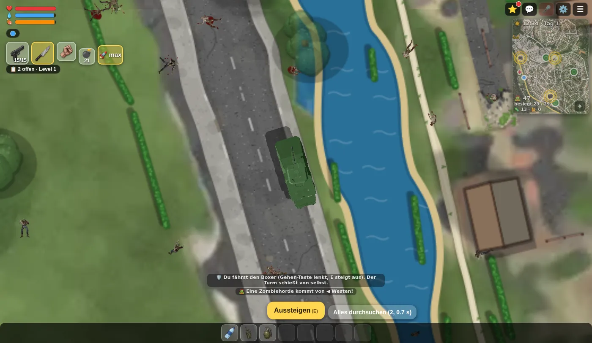
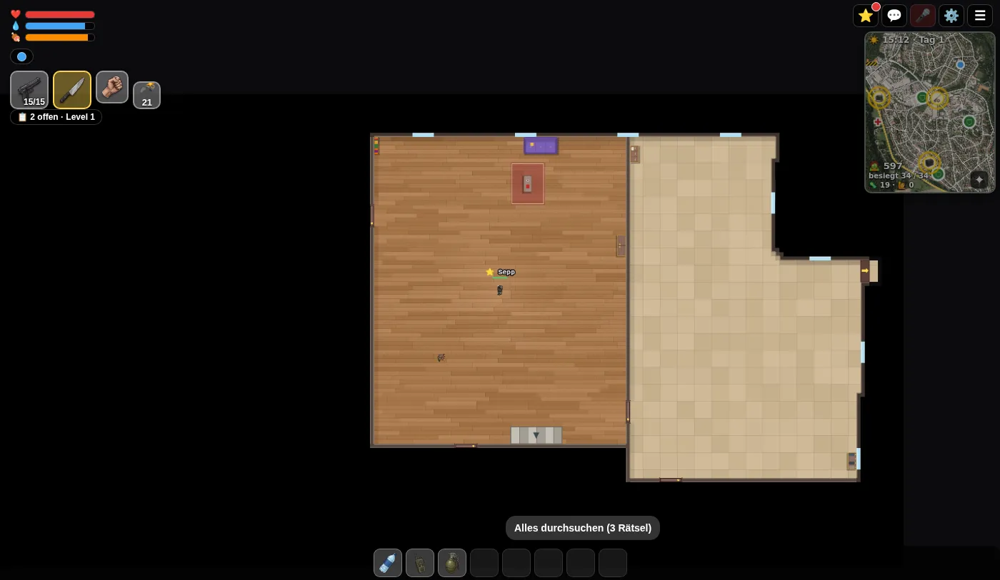

<h1 align="center">🧟 Zombies in Oberbayern</h1>

  <b>Co-op zombie survival for 2–10 players in the phone browser – game server as a Home Assistant add-on.</b> 
  A village party in Upper Bavaria turns into a zombie apocalypse. Sneak past, stick together and help each other up.

  

  
  
  
  
  
  
  

---

**Deutsch** · [English](#english)

> **Hinweis / Content warning:** Das Spiel enthält Gewalt gegen Zombies, Schusswaffen und Horror-Atmosphäre. Empfohlen ab 16 Jahren. Alles ist Fiktion; Orte, Namen und Organisationen sind zufällige Kulisse und stehen in keiner Verbindung zum Spiel.

  
  

## Deutsch

### Was ist das?

**Zombies in Oberbayern** ist ein kooperatives Zombie-Survival für 1–10 Spieler, das im Browser läuft (Handy oder PC).
Das Add-on ist der Spielserver für Home Assistant: Er liefert das Spiel aus und entscheidet über Bewegung, Zombies und
Treffer. Ihr spielt gemeinsam in einer Stadt in Oberbayern (Karten nach echten Daten von OpenStreetMap und den
bayerischen Geodaten), durchsucht Häuser, Autos und Schränke, verbarrikadiert euch in Safe Rooms, rettet Mitspieler
und löst die Rätsel am Ortstor. Wer gebissen wird, braucht eine Rettungsspritze, sonst verwandelt er sich.

Das Spiel selbst ist **deutschsprachig**. Version 0.x: Es ist in aktiver Entwicklung, Levelfolge und Inhalte wachsen noch.

### Bilder

| | |
|---|---|
|  |  |
| Startseite: Name und Figur wählen | Dein Start: Fähigkeiten und Startgegenstände |
|  |  |
| Zombies auf der Straße | Bundeswehr-Lager mit Sanitätszelt |
|  |  |
| Fahrbares Fahrzeug | Im Haus (Grundriss mit Zimmern) |
|  | |
| Nachts hilft nur die Taschenlampe | |

### Installation

1. In Home Assistant: **Einstellungen → Add-ons → Add-on-Store → ⋮ → Repositories**, dort
   `https://github.com/gregorwolf1973/zombies-addon` hinzufügen (oder den Knopf oben benutzen).
2. **Zombies in Oberbayern** installieren und starten.
3. In der Seitenleiste **Zombies** öffnen („▶ Hier spielen“), oder Mitspieler über Port **8775** einladen,
   z. B. `http://homeassistant.local:8775`.

Von außen (Internet) braucht ihr einen Reverse Proxy oder Cloudflare-Tunnel auf Port 8775 (WebSockets müssen
durchgereicht werden). **Setzt dann unbedingt die Option `zugangscode`**, sonst kann jeder mitspielen. Für das
Mikrofon (Sprachfunk) verlangt der Browser https: Trage dafür die https-Adresse als `externe_adresse` ein.

### Spielen

- **Handy:** auf den Bildschirm tippen und ziehen (virtueller Joystick); wenig ziehen heißt schleichen.
- **PC:** WASD oder Pfeiltasten, Umschalttaste zum Schleichen, Mausrad zum Zoomen.
- Angegriffen wird automatisch: mit Pistole auf Abstand, sonst wird gestoßen.
- **Aktionsknopf** (unten rechts) oder **E**: durchsuchen, verbarrikadieren, Vorratskiste öffnen, Fahrzeug betreten/verlassen.
- **Rucksack** unten: antippen zum Benutzen oder Wegwerfen, am PC Tasten 1–8.
- **Fahrzeuge:** lenken wie beim Gehen. Im Fahrzeug schaltet der Tempo-Knopf (🐢 30 / 50 / 🚀 max) oder die Taste **T** das
  Höchsttempo reihum; am PC macht gedrückte **Umschalttaste** langsam (30 km/h).
- Wer am Boden liegt, steht wieder auf, wenn ein Mitspieler neben ihm bleibt.
- Abmelden geht nur in einem Safe Room; wer draußen geht, wartet 2 Minuten und taucht im letzten Safe Room auf.
- Häuser sind betretbar (Dach blendet aus), innen ist es dunkel: eine **Taschenlampe** leuchtet weit voraus.

### Mehrspieler und Sprachfunk

Bis zu 10 Spieler teilen eine Welt; der Server ist maßgeblich für Bewegung, Zombies und Treffer. Verbindungsabbrüche
verzeihen das Spiel 2 Minuten, danach steigt ihr automatisch wieder ein. Der Sprachfunk läuft direkt zwischen den
Browsern (WebRTC); der STUN-Server steht in der Option `stun_server` (Standard: ein öffentlicher Google-STUN-Server,
dorthin gehen dann die IP-Adressen – leer lassen schaltet ihn ab). Hinter strengen Firewalls hilft ein eigener TURN-Server.
Wer allein spielt, kann mit der Option `bots` simulierte Mitspieler dazuschalten.

### Einstellungen

Das meiste stellst du bequem im Add-on selbst ein (Seitenleiste **Zombies** → Zahnrad). Die Add-on-Optionen
dienen nur als Startwerte beim allerersten Start:

| Option | Bedeutung |
|---|---|
| `externe_adresse` | https-Adresse von außen (Mikrofon) |
| `stun_server`, `turn_*` | Sprachfunk-Server (STUN, optional TURN-Relais) |

Alle anderen Einstellungen (Karte, Zombies, Funde, Zugangscode, Bots, Wiki-Adresse, Impressum, Datenschutz …) stehen auf der Einstellungsseite des Spiels (Seitenleiste, Gruppe „Zugang & Test“).

Mehr dazu im Reiter „Dokumentation“ des Add-ons (`zombies/DOCS.md`).

### Töne und Musik

Aus Lizenzgründen sind **keine Ton- oder Musikdateien** enthalten. Ohne eigene Dateien erzeugt das Spiel seine Töne
selbst. Eigene Töne (MP3, OGG, WAV, M4A bis 8 MB) lassen sich in der Verwaltung hochladen und Ereignissen zuordnen oder
unter `/share/zombies/toene` ablegen.

### Systemanforderungen

- Home Assistant OS oder Supervised, Architektur **amd64** oder **aarch64** (z. B. Raspberry Pi 4/5, Mini-PC).
- Der Server braucht im Betrieb grob **400 MB RAM** (gemessen 325–420 MB mit einem Spieler und rund 40 Zombies, mehr
  bei vielen Spielern/Hordengrößen) und ein bis zwei CPU-Kerne; für 10 Spieler lieber einen Mini-PC als einen Pi 3.
- Speicherplatz: Image einige hundert MB plus Spielstand (wenige MB) in `/data`.
- Spieler: ein aktueller Browser (Chrome, Safari, Firefox, Edge); Handy oder PC, WLAN genügt.

### Technik und Tests

[Colyseus](https://colyseus.io/) 0.18 auf Node.js 22 (Server), [Phaser](https://phaser.io/) 3 (Browser).
Entwicklung: `cd zombies && npm install && npm test`, Start mit `npm start` (http://localhost:2567).

### Credits und Lizenz

Quellen, Autoren und Lizenzen aller Grafiken, Karten, Fragen und Bibliotheken stehen in [CREDITS.md](CREDITS.md).
Der **Quellcode** steht unter der [MIT-Lizenz](LICENSE); Grafiken, Karten und Texte haben die in CREDITS.md genannten,
teils abweichenden Lizenzen (z. B. CC BY, ODbL).

Gefällt dir das Projekt? [Buy me a coffee](https://buymeacoffee.com/gregorwolf1973) · [Liberapay](https://liberapay.com/Gregor_Wolf/donate)

---

## English

> **Content warning:** zombie violence, firearms and a horror atmosphere. Recommended for ages 16 and up. Everything is fiction; places, names and organisations are incidental scenery and have no connection to the game.

### What is this?

**Zombies in Oberbayern** ("Zombies in Upper Bavaria") is a cooperative zombie-survival game for 1–10 players that runs in
the browser (phone or PC). This add-on is the game server for Home Assistant: it serves the game and is authoritative
for movement, zombies and hits. Together you survive in a town in Upper Bavaria (maps built from OpenStreetMap and
Bavarian open geodata): search houses, cars and cupboards, barricade yourselves in safe rooms, revive teammates and solve
the quiz locks on the town gate. A bitten player needs a rescue syringe or turns into a zombie.

The game itself is **in German** (there is no English UI yet). It is at version 0.x and still in active development.

### Screenshots

See the table in the German section above: start page, starting choice (skills and items), zombies in the street, the
military base, a drivable vehicle, a house interior and a night scene with a torch.

### Installation

1. In Home Assistant open **Settings → Add-ons → Add-on Store → ⋮ → Repositories** and add
   `https://github.com/gregorwolf1973/zombies-addon` (or use the button at the top).
2. Install **Zombies in Oberbayern** and start it.
3. Open **Zombies** in the sidebar ("▶ Hier spielen"), or invite friends via port **8775**, e.g.
   `http://homeassistant.local:8775`.

To play over the internet, put a reverse proxy or a Cloudflare tunnel in front of port 8775 (WebSockets must be passed
through). **Always set the `zugangscode` (access code) option then**, otherwise anyone can join. Browsers only allow the
microphone (voice chat) over https: enter your https address as `externe_adresse`.

### How to play

- **Phone:** touch and drag on the screen (virtual joystick); dragging only a little means sneaking.
- **PC:** WASD or arrow keys, Shift to sneak, mouse wheel to zoom.
- Attacks are automatic: with a pistol from a distance, otherwise you shove.
- **Action button** (bottom right) or **E**: search, barricade, open the supply chest, enter/leave a vehicle.
- **Backpack** at the bottom: tap to use or drop, on PC keys 1–8.
- **Vehicles:** steer like walking. While driving, the speed button (🐢 30 / 50 / 🚀 max) or the **T** key cycles through
  the top-speed steps; on PC holding **Shift** drives slowly (30 km/h).
- A downed player gets up again when a teammate stays next to them.
- You can only log out inside a safe room; if you leave outside, your character waits for 2 minutes and reappears in the last safe room.
- Houses can be entered (the roof fades away); it is dark inside – a **torch** lights the way.

### Multiplayer and voice chat

Up to 10 players share one world; the server is authoritative. Dropped connections are forgiven for 2 minutes, then you
rejoin automatically. Voice chat runs directly between browsers (WebRTC). The STUN server is set with the `stun_server`
option (default: a public Google STUN server, which then sees player IP addresses – leave it empty to disable). Behind
strict firewalls your own TURN server helps. Playing alone, the `bots` option adds simulated teammates.

### Settings

Most settings are changed in the add-on's own panel (sidebar **Zombies** → gear icon). The add-on options are only the
initial values for the very first start:

| Option | Meaning |
|---|---|
| `externe_adresse` | External https address (needed for the microphone) |
| `stun_server`, `turn_*` | Voice chat servers (STUN, optional TURN relay) |

All other settings (map, zombies, finds, access code, bots, wiki address, imprint, privacy notice …) are on the game's settings page (sidebar).

More details are in the add-on's "Documentation" tab (`zombies/DOCS.md`).

### Sounds and music

For licensing reasons **no audio files are included**. Without your own files the game synthesises its sounds. You can
upload your own sounds (MP3, OGG, WAV, M4A up to 8 MB) in the add-on's admin panel and assign them to events, or put them
into `/share/zombies/toene`.

### System requirements

- Home Assistant OS or Supervised on **amd64** or **aarch64** (e.g. Raspberry Pi 4/5, mini PC).
- Roughly **400 MB RAM** while running (measured 325–420 MB with one player and about 40 zombies; more with many players
  or big hordes) and one to two CPU cores; for 10 players prefer a mini PC over a Pi 3.
- Disk: image a few hundred MB plus a few MB of save data in `/data`.
- Players: a current browser (Chrome, Safari, Firefox, Edge) on phone or PC; Wi-Fi is enough.

### Tech and tests

[Colyseus](https://colyseus.io/) 0.18 on Node.js 22 (server), [Phaser](https://phaser.io/) 3 (browser).
Development: `cd zombies && npm install && npm test`, start with `npm start` (http://localhost:2567).

### Credits and license

Sources, authors and licenses of all graphics, maps, questions and libraries are listed in [CREDITS.md](CREDITS.md).
The **source code** is under the [MIT license](LICENSE); graphics, maps and texts carry the (partly different) licenses
named in CREDITS.md (e.g. CC BY, ODbL).

Like the project? [Buy me a coffee](https://buymeacoffee.com/gregorwolf1973) · [Liberapay](https://liberapay.com/Gregor_Wolf/donate)
